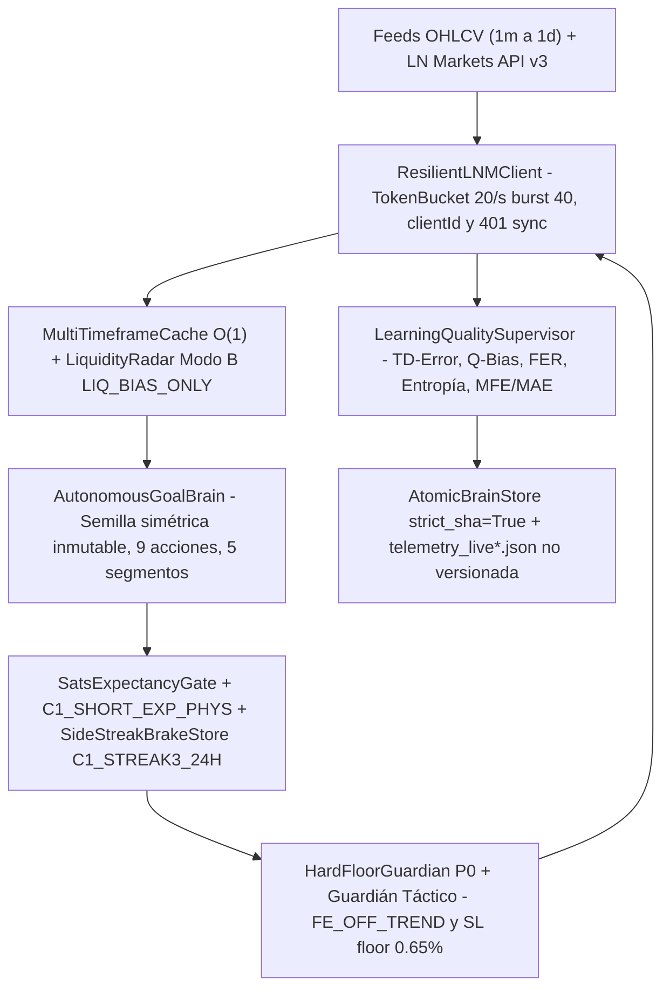

# LNM Sniper v7.3+ — Edición `C1_STREAK3_24H_INV`

**Motor autónomo de trading cuantitativo para futuros inversos perpetuos de Bitcoin (`BTCUSD`) en LN Markets (API v3)** con arquitectura dual (`Mainnet` + `Testnet`), política determinista simétrica inmutable en RAM, freno discreto persistente por lado (`C1_STREAK3_24H`), radar de liquidez en **Modo B (`LIQ_BIAS_ONLY`)**, supervisión matemática en tiempo real y protecciones de capital P0.

Optimizado en Python puro (`requests` + `numpy`) con bloqueo POSIX (`fcntl`) y latencia de ciclo $O(1)$ para ejecutarse de forma ligera en **Linux**, **WSL (`Ubuntu`)** y **Android Termux (`aarch64`)** sin dependencias C/C++ pesadas.

---

## Tabla de Contenidos

1. [Arquitectura General](#arquitectura-general)
2. [Arquitectura Cuantitativa Vigente (`C1_STREAK3_24H_INV`)](#arquitectura-cuantitativa-vigente-c1_streak3_24h_inv)
3. [Parámetros Críticos Efectivos de Arranque](#parámetros-críticos-efectivos-de-arranque)
4. [Métricas Certificadas OOS y Estrés (`inverse_contract_math=True`)](#métricas-certificadas-oos-y-estrés-inverse_contract_mathtrue)
5. [Requisitos, Instalación y Despliegue en Termux](#requisitos-instalación-y-despliegue-en-termux)
6. [Credenciales (`.env`) y Flags Directos del Bot](#credenciales-env-y-flags-directos-del-bot)
7. [Operación Diaria con `sniper_cli.py`](#operación-diaria-con-sniper_clipy)
8. [Perfiles Cuantitativos, Umbrales y Runtime](#perfiles-cuantitativos-umbrales-y-runtime)
9. [Simulación, Entrenamiento Offline y Certificación](#simulación-entrenamiento-offline-y-certificación)
10. [Pruebas Automatizadas y Verificación (`11` Suites)](#pruebas-automatizadas-y-verificación-11-suites)
11. [Mapa Completo del Repositorio](#mapa-completo-del-repositorio)
12. [Reglas P0, Gobernanza y Aviso de Riesgo](#reglas-p0-gobernanza-y-aviso-de-riesgo)

---

## Arquitectura General



---

## Arquitectura Cuantitativa Vigente (`C1_STREAK3_24H_INV`)

El sistema conserva intacto el contrato de 9 acciones discretas (`0`: `HOLD`, `1..4`: `LONG`, `5..8`: `SHORT`) y el esquema de estado de 5 segmentos (`REGIME|OSC|CONC|MACRO|EMA`), operando bajo las garantías auditadas de la edición `C1_STREAK3_24H_INV`:

- **Aislamiento Determinista en Memoria (`DETERMINISTIC_TREND_POLICY = True`):**
  - El motor de entrada, el ranking y `estimate_bayesian_win_rate` utilizan en RAM la semilla simétrica limpia e inmutable (sin sesgo direccional, sin cascada `TREND -> SNIPER` y con `lcb_penalty = 0.0`).
  - Se omiten valores `Q`, `state_visits`, `style_metrics`, penalizaciones CQL, `expectancy_boost` y `runtime_shadow_cb` provenientes de archivos `q_brain_*.json` legados en disco, manteniendo intacta la validación criptográfica `strict_sha=True` (`AtomicBrainStore`).
- **Asimetría Física en Cortos (`C1_SHORT_EXP_PHYS`) y `E2_FE_OFF`:**
  - `L_TREND` opera con piso físico `TREND_SL_FLOOR_PCT = 0.0065` (`0.65%`).
  - `S_TREND` requiere expansión orgánica de volatilidad **`SHORT_EXP_MIN_DSL = 0.006505`** (`0.6505%`): si la distancia al stop loss es $\le 0.6505\%$, bloquea la entrada hacia `HOLD` (`BLOCKED_SHORT_NO_EXPANSION`).
  - `FE_OFF_TREND = True` desactiva salidas prematuras por `FORCED_EDGE_EXIT` en trades tendenciales.
- **Freno Discreto por Lado Persistente (`C1_STREAK3_24H`, [`side_streak_brake.py`](side_streak_brake.py)):**
  - Contadores independientes por lado (`buy` y `sell`) con lectura `is_side_paused` en $O(1)$ puramente en RAM sin I/O bloqueante en el bucle de `5s`.
  - Al acumular **3 pérdidas consecutivas** (`net_pnl_sats <= 0`) en un lado, pausa únicamente ese lado durante **24 horas** (`86,400 s`), manteniendo libre el lado contrario.
  - Persiste al cierre de operaciones con escritura atómica (`tmp + os.fsync + os.replace`), bloqueo POSIX `fcntl` y verificación `.sha256` en `$HOME/.sniper_state/`.
- **Radar de Liquidez en Modo B (`LIQ_BIAS_ONLY`, [`liquidity_radar.py`](liquidity_radar.py)):**
  - Validado por selección A/B sobre 18 meses reales (`liquidity_radar.enabled = 1`, `liquidity_radar.shadow_only = 0`, `liquidity_radar.opposite_wall_enabled = 0`). Aporta sesgo direccional sin activar vetos por muros opuestos en `TREND`.
- **Resiliencia API v3, Concurrencia y Apagado Limpio:**
  - `ResilientLNMClient` ([`guardian_execution_core.py`](guardian_execution_core.py)) incorpora `TokenBucket(rate=20.0/s, capacity=40.0)`, generación de `clientId` único e idempotente (`generate_client_id`) en `open_trade()`, firma HMAC-SHA256 y auto-sincronización de reloj ante `HTTP 401 outdated timestamp`.
  - `_handle_shutdown_signal` ([`lnm_sniper_v6_advanced.py`](lnm_sniper_v6_advanced.py)) ejecuta parada lock-free segura ante `SIGTERM`/`SIGINT` con sueño interrumpible (`0.25s`) y limpieza `try/finally`.
- **Módulos Explícitamente Desactivados en Producción:**
  - **Hybrid Edge Hedging (`ENABLE_HYBRID_HEDGE = False`):** desactivado por defecto en runtime, catálogo y todos los presets.
  - **Órdenes Límite en Retroceso (`limit_execution.enabled = 0`):** desactivadas en `TREND` por selección adversa.
  - **Veto por Muro Opuesto (`liquidity_radar.opposite_wall_enabled = 0`) y `FORCED_EDGE_EXIT` en `TREND` (`FE_OFF_TREND = True`).**

---

## Parámetros Críticos Efectivos de Arranque

Valores verificados en tiempo de arranque (`python3 -B lnm_sniper_v6_advanced.py --dry-check` y `Config`):

| Parámetro / Bandera | Valor Vigente | Alcance / Protección |
| :--- | :---: | :--- |
| `ENABLE_HYBRID_HEDGE` | `False` | Cobertura híbrida deshabilitada |
| `DETERMINISTIC_TREND_POLICY` | `True` | Política simétrica determinista inmutable en RAM |
| `FE_OFF_TREND` | `True` | Sin cierres prematuros `FORCED_EDGE_EXIT` en `TREND` |
| `limit_execution.enabled` | `0` (`False`) | Ejecución a mercado sin retrocesos `LIMIT` |
| `liquidity_radar.enabled` | `1` (`True`) | Radar de liquidez activo |
| `liquidity_radar.shadow_only` | `0` (`False`) | Modo B `LIQ_BIAS_ONLY` activo |
| `liquidity_radar.opposite_wall_enabled` | `0` (`False`) | `BLOCKED_OPPOSITE_LIQ_WALL` desactivado |
| `BASE_RISK_PCT_STD` | `0.0075` (`0.75%`) | Riesgo base por operación sobre equity disponible |
| `RECOVERY_ENTER_DD` | `0.035` (`3.5%`) | Entrada a modo recuperación (`HOLD` limpio) |
| `DD_THROTTLE_HALT_PCT` | `0.045` (`4.5%`) | Contención estricta de drawdown |
| `MAX_DD_GUARD_PCT` | `0.052` (`5.2%`) | Guarda dura de drawdown máximo en vivo y simulador |
| `TREND_SL_FLOOR_PCT` | `0.0065` (`0.65%`) | Piso mínimo físico de Stop Loss |
| `SHORT_EXP_MIN_DSL` | `0.006505` (`0.6505%`) | Umbral mínimo de expansión física para `S_TREND` |
| `MAX_CONCURRENT_TRADES` | `5` | Tope estricto compartido en `mainnet` y `testnet` |

---

## Métricas Certificadas OOS y Estrés (`inverse_contract_math=True`)

Resultados reproducibles directamente con [`SimTrainingEnvironment`](simulation/sim_training_environment.py) usando la configuración vigente del repositorio (**Modo B `LIQ_BIAS_ONLY`**, comisión de referencia `0.20% RT`):

| Ventana / Escenario | Trades | Neto (sats) | PF | MaxDD | Meses `DD >= 4.5%` | DDG / OTR / FE | Meses Tendenciales Clave |
| :--- | :---: | :---: | :---: | :---: | :---: | :---: | :--- |
| **Fold 1 OOS (`M13..M18`) — Paridad Directa Repo** | `130` | **`+26,933`** | **`1.73`** (`1.729`) | `4.10%` | `0/6` | `0 / 0 / 0` | **`M16 BULL = +31,746 sats`** (`N=52`, `DD=3.87%`) |
| **Fold 2 OOS (`M01..M06`)** | `247` | `-8,841` | `0.899` | `4.40%` | `0/6` | `0 / — / 0` | **`M02 BULL = +12,750 sats`** |
| **Semestre 2 (`M07..M12`)** | `295` | `-26,288` | `0.745` | `4.66%` | `1/6` | `0 / — / 0` | **`M09 BEAR = +8,392 sats`** |
| **`12M OOS` (`F1 + F2` @ `0.20% RT`)** | `377` | **`+18,092`** | `1.145` | `4.40%` | `0/12` | `0` DDG | Sube a `+31,603` (`0.15% RT`) y `+45,104` (`0.10% RT`) |
| **`Total 18M` (`M01..M18` @ `0.20% RT`)** | `672` | `-8,196` | `0.964` | `4.66%` | `1/18` | `0` DDG | Sube a `+14,938` (`0.15% RT`) y `+38,049` (`0.10% RT`) |

- **Estrés de Microestructura (`12M OOS`, `+50%` slippage + `1-bar` latencia):** `+13,488 sats`, `PF = 1.11`, `MaxDD = 4.63%`, `DDG = 0`.
- **Monte Carlo (`1,000` trayectorias *block-bootstrap*, `12M OOS @ 0.20% RT`):** `P(Net > 0) = 62.10%`, mediana `P50 = +9,790 sats` (`PF P50 = 1.08`), `P95 RealDD = 3.83%`, `P(DDG >= 5.2%) = 0.00%`, `P(HardFloor) = 0.00%`.

---

## Requisitos, Instalación y Despliegue en Termux

- **Python:** `3.9+` (probado en Python `3.12` WSL Ubuntu y compatible con Termux `aarch64`).
- **Sistema:** Linux, WSL (`Ubuntu`) o Android Termux (con soporte POSIX `fcntl`).
- **Dependencias:** `requests` y `numpy`.

```bash
# En WSL (Ubuntu) o Linux
git clone https://github.com/felipemonsalve28-eng/lnmsniper.git
cd lnmsniper
pip install requests numpy
python3 -B lnm_sniper_v6_advanced.py --dry-check

# En Android Termux
pkg update && pkg install -y python git
pip install --upgrade pip requests numpy
git clone https://github.com/felipemonsalve28-eng/lnmsniper.git
cd lnmsniper
python3 -B lnm_sniper_v6_advanced.py --dry-check
```

### Higiene de Actualización (`git pull --ff-only` en Termux)

- Los archivos efímeros `telemetry_live*.json`, `side_brake_state_*.json*`, logs (`*.log`, `*.log.*`), `.env` y respaldos locales están excluidos en [`.gitignore`](.gitignore) para evitar conflictos durante `git pull --ff-only`.
- El estado del freno por lado vive de forma aislada en `$HOME/.sniper_state/`.
- Si un demonio en vivo actualiza alguno de los 4 archivos JSON semilla (`q_brain_*_lnm.json` o `hedge_state_*.json`) localmente en Termux, protege tu árbol antes de futuros `git pull --ff-only` marcándolos temporalmente con:
  ```bash
  git update-index --skip-worktree q_brain_advanced_lnm.json q_brain_testnet_lnm.json hedge_state_mainnet.json hedge_state_testnet.json
  ```

---

## Credenciales (`.env`) y Flags Directos del Bot

Crea `.env` en la raíz del proyecto (permisos `chmod 600 .env`) con credenciales **LN Markets API v3**:

```env
# Producción (Mainnet)
LNM_API_KEY=tu_api_key_v3_mainnet
LNM_API_SECRET=tu_api_secret_v3_mainnet
LNM_PASSPHRASE=tu_passphrase_mainnet

# Explorador (Testnet / Signet)
LNM_TESTNET_API_KEY=tu_api_key_v3_testnet
LNM_TESTNET_API_SECRET=tu_api_secret_v3_testnet
LNM_TESTNET_PASSPHRASE=tu_passphrase_testnet
```

> `load_saved_credentials()` busca variables de entorno, `.env`, `~/.env` y `~/.bashrc`.

### Flags de [`lnm_sniper_v6_advanced.py`](lnm_sniper_v6_advanced.py)

```bash
python3 -B lnm_sniper_v6_advanced.py --help
```

| Flag | Descripción |
| :--- | :--- |
| `--env {mainnet\|testnet}` | Selecciona entorno de ejecución |
| `--testnet` | Atajo equivalente a `--env testnet` |
| `--safe-mode` | Gestiona posiciones abiertas sin abrir nuevas entradas |
| `--once` | Ejecuta un ciclo único y termina |
| `--dry-check` | Valida configuración efectiva sin credenciales ni red |
| `-h, --help` | Muestra la ayuda y termina |

---

## Operación Diaria con `sniper_cli.py`

[`sniper_cli.py`](sniper_cli.py) es el centro de mando principal del bot con arranque ligero (*lazy imports*), adaptación a pantallas estrechas de Termux y recarga en caliente (`SIGHUP`):

```bash
# Menú interactivo guiado
python3 sniper_cli.py
```

| Acción | Comando |
| :--- | :--- |
| **Estado en vivo (API v3 + cerebros + RL)** | `python3 sniper_cli.py status --env mainnet` |
| **Estado offline (archivos locales sin red)** | `python3 sniper_cli.py status --env mainnet --offline` |
| **Monitor continuo con auto-refresco** | `python3 sniper_cli.py watch --env mainnet --interval 3` |
| **Iniciar / Reiniciar / Detener demonio** | `python3 sniper_cli.py daemon start --env mainnet` (`stop` / `restart` / `reload`) |
| **Iniciar demonio en `--safe-mode` o `--shadow`** | `python3 sniper_cli.py daemon start --env mainnet --safe-mode` |
| **Inspeccionar logs del demonio** | `python3 sniper_cli.py daemon logs --env mainnet --lines 40` |
| **Explorar catálogo de `100` parámetros (`12` categorías)** | `python3 sniper_cli.py catalog --search liquidity_radar` |
| **Ver ficha técnica y rango de un umbral** | `python3 sniper_cli.py explain opposite_wall_enabled` |
| **Modificar umbral con Hot-Reload atómico** | `python3 sniper_cli.py set trailing_tighten_factor 0.85` |
| **Listar / Editar `28` parámetros de runtime** | `python3 sniper_cli.py runtime-list` / `runtime-set MAX_LEVERAGE 60` |
| **Restaurar overrides de runtime a fábrica** | `python3 sniper_cli.py runtime-reset` |
| **Administrar cerebros (`info`, `set-target`, `sync`, `init-clean`)** | `python3 sniper_cli.py brain sync --dry-run` |

> **Nota sobre [`setup_dual_sniper.sh`](setup_dual_sniper.sh):** este script heredado sigue disponible para rotación manual de logs o utilidades puntuales, pero no debe mezclarse en paralelo con los demonios gestionados por `sniper_cli.py daemon`.

---

## Perfiles Cuantitativos, Umbrales y Runtime

- **Umbrales (`100` parámetros en `12` categorías):** `expectancy`, `fees`, `td_error`, `q_calibration`, `policy_entropy`, `mfe_mae`, `reward`, `exploration`, `learning_guard`, `market_sensitivity`, `liquidity_radar` y `limit_execution` en [`config/learning_thresholds.json`](config/learning_thresholds.json) y [`config/learning_thresholds_testnet.json`](config/learning_thresholds_testnet.json).
- **Runtime (`28` parámetros tácticos):** definidos en [`sniper_cli_catalog.py`](sniper_cli_catalog.py) (`26` atributos de `Config`, `SAFE_MODE` vía CLI/entorno y `MAX_HEDGE_LEVERAGE` en `HedgeRiskManager`).
- **Perfiles (`5` presets):** todos mantienen `ENABLE_HYBRID_HEDGE = False` por defecto:

| Preset | Enfoque |
| :--- | :--- |
| `baseline_v73` | Calibración oficial certificada LNM Sniper v7.3+ (Monte Carlo Baseline) |
| `capital_fortress` | Escudo institucional defensivo de preservación de satoshis |
| `fee_sniper_anti_chop` | Erradicador de *fee-drag* y filtro anti-chop lateral / squeeze |
| `trend_expansion_kelly` | Captura de tendencia direccional y expansión de volatilidad |
| `testnet_curriculum_lab` | Exploración curricular acelerada (exclusivo Testnet/Shadow; bloqueado P0 en Mainnet) |

```bash
python3 sniper_cli.py presets list
python3 sniper_cli.py presets show baseline_v73
python3 sniper_cli.py presets apply baseline_v73 --env mainnet
```

---

## Simulación, Entrenamiento Offline y Certificación

```bash
# 1. Descargar histórico de velas 1m (guardado en simulation/data/, ignorado en Git)
python3 -B simulation/download_historical_data.py

# 2. Entrenar cerebro candidato aislado con paridad inversa
python3 -B simulation/train_candidate_brain.py --reset

# 3. Certificar compuertas Schema v2, P0 y Monte Carlo antes de promover
python3 -B simulation/certify_and_promote_candidate.py

# Utilidades complementarias de recalibración y Walk-Forward OOS
python3 -B retrain_sats_offline.py
python3 -B validate_walk_forward_oos.py
```

---

## Pruebas Automatizadas y Verificación (`11` Suites)

Ejecuta todas las suites **de forma secuencial** dentro de WSL (`Ubuntu`) o Linux usando `python3 -B`:

```bash
for s in \
  test_anti_whipsaw_hedge.py \
  test_c1_streak3_24h_production.py \
  test_candidate_certification.py \
  test_learning_quality_and_sats.py \
  test_limit_execution_manager.py \
  test_liquidity_radar.py \
  test_protocolo_v_reversal.py \
  test_simulation_engine.py \
  test_simulation_training_loop.py \
  test_sniper_cli.py \
  test_terminal_bellman_fix.py; do
  python3 -B "$s" || exit 1
done

# Compilación estática de los 41 archivos Python
python3 -B -m py_compile *.py simulation/*.py
```

- En auditoría certificada previa (`11/11 PASS`), todas las suites pasaron en secuencia sin ensuciar los archivos trackeados y con `strict_sha=True` verificado sobre [`q_brain_advanced_lnm.json`](q_brain_advanced_lnm.json), [`q_brain_testnet_lnm.json`](q_brain_testnet_lnm.json), [`hedge_state_mainnet.json`](hedge_state_mainnet.json) y [`hedge_state_testnet.json`](hedge_state_testnet.json).

---

## Mapa Completo del Repositorio

| Archivo / Directorio | Responsabilidad Principal |
| :--- | :--- |
| [`lnm_sniper_v6_advanced.py`](lnm_sniper_v6_advanced.py) | Bucle principal `5s`, `MultiTimeframeCache`, `AutonomousGoalBrain`, `evaluate_and_dispatch_entries`, `--dry-check` y parada limpia `SIGTERM`/`SIGINT` |
| [`guardian_execution_core.py`](guardian_execution_core.py) | `AtomicBrainStore` (`strict_sha=True`), `FileLockContext` POSIX, `HardFloorGuardian` (P0), `TokenBucket` (`20/s`, burst `40`) y `ResilientLNMClient` |
| [`sniper_perception_sats_core.py`](sniper_perception_sats_core.py) | Clasificador de regímenes, `ShortTermPerceptionEngine`, `estimate_bayesian_win_rate`, `verify_net_sats_expectancy` y desglose neto inverso |
| [`side_streak_brake.py`](side_streak_brake.py) | Freno persistente por lado `C1_STREAK3_24H` (`SideStreakBrakeStore`) con lectura $O(1)$ en RAM y firma `.sha256` en `$HOME/.sniper_state/` |
| [`liquidity_radar.py`](liquidity_radar.py) | Pools `EQH/EQL`, *Sweep+Reclaim* sin *look-ahead*, y `LiquidityConfig` (**Modo B `LIQ_BIAS_ONLY`**, `opposite_wall_enabled = 0`) |
| [`limit_execution_manager.py`](limit_execution_manager.py) | Gestor de órdenes límite pasivas con persistencia atómica (deshabilitado por defecto con `limit_execution.enabled = 0`) |
| [`learning_thresholds_manager.py`](learning_thresholds_manager.py) | Hot-Reload atómico, validación estricta de esquema (`12` categorías / `100` parámetros) y candado estructural ante posiciones abiertas |
| [`learning_quality_supervisor.py`](learning_quality_supervisor.py) | Supervisión $O(1)$ de `TD-Error`, `Q-Bias`, `FER`, `Entropía`, `MFE/MAE` y despachador atómico de `telemetry_live*.json` |
| [`config/learning_thresholds.json`](config/learning_thresholds.json) | Umbrales vigentes de producción (`Mainnet`) y par [`config/learning_thresholds_testnet.json`](config/learning_thresholds_testnet.json) (`Testnet`) |
| [`sniper_cli.py`](sniper_cli.py) / [`sniper_cli_catalog.py`](sniper_cli_catalog.py) | Centro de mando CLI optimizado para Termux, catálogo de `100` umbrales, `28` parámetros runtime y `5` presets |
| [`edge_monitor.py`](edge_monitor.py), [`predictive_hedge.py`](predictive_hedge.py), [`portfolio_hedge.py`](portfolio_hedge.py), [`hedge_risk_manager.py`](hedge_risk_manager.py), [`dynamic_hedge.py`](dynamic_hedge.py), [`adaptive_controller.py`](adaptive_controller.py), [`hedge_state_store.py`](hedge_state_store.py) | Subsistema completo de cobertura híbrida con máquina de 7 estados y persistencia `.sha256` (apagado en producción mediante `ENABLE_HYBRID_HEDGE = False`) |
| [`sync_brains_dual.py`](sync_brains_dual.py) / [`init_clean_brains.py`](init_clean_brains.py) | Sincronización dual atómica e inicialización limpia de cerebros manteniendo esquema v2 |
| [`retrain_sats_offline.py`](retrain_sats_offline.py) / [`validate_walk_forward_oos.py`](validate_walk_forward_oos.py) / [`audit_shadow_convergence.py`](audit_shadow_convergence.py) | Recalibración offline orientada a satoshis, reporte Walk-Forward OOS y auditoría de convergencia shadow |
| `simulation/` | Exchange simulado inverso (`sim_lnm_exchange.py`), `PrecomputedMarketFeed` (`sim_market_feed.py`), `SimTrainingEnvironment`, descarga de velas, entrenamiento y certificación Monte Carlo |
| `test_*.py` | `11` suites automatizadas unitarias, cuantitativas, de paridad OOS y CLI |
| [`AGENTS.md`](AGENTS.md), [`AGENT_MAINTENANCE_DIRECTIVE.md`](AGENT_MAINTENANCE_DIRECTIVE.md), [`CONTEXT_LNM_SNIPER.md`](CONTEXT_LNM_SNIPER.md) | Gobernanza por etapas, reglas P0, arquitectura de subagentes y memoria técnica del proyecto |

---

## Reglas P0, Gobernanza y Aviso de Riesgo

1. **Invariantes P0 inviolables:** 9 acciones discretas (`0..8`), estado de 5 segmentos, contabilidad neta sin doble descuento de comisiones, subordinación estricta a `HardFloorGuardian`, máximo `5` posiciones concurrentes en `mainnet` y `testnet`, retorno 3-tupla `(h, l, c)` en `MultiTimeframeCache.get_candles()` y persistencia `AtomicBrainStore` con `strict_sha=True`.
2. **Gobernanza:** Todo cambio estructural debe seguir las etapas definidas en [`AGENT_MAINTENANCE_DIRECTIVE.md`](AGENT_MAINTENANCE_DIRECTIVE.md) y la ejecución de `python3` / `git` en **WSL (`Ubuntu`)** descrita en [`AGENTS.md`](AGENTS.md).
3. **Aviso de riesgo:** Operar derivados perpetuos apalancados conlleva riesgo real de pérdida de capital. Valida siempre credenciales, umbrales y arranque (`--dry-check`, `--testnet` o `--safe-mode`) antes de operar con capital real en `Mainnet`.
