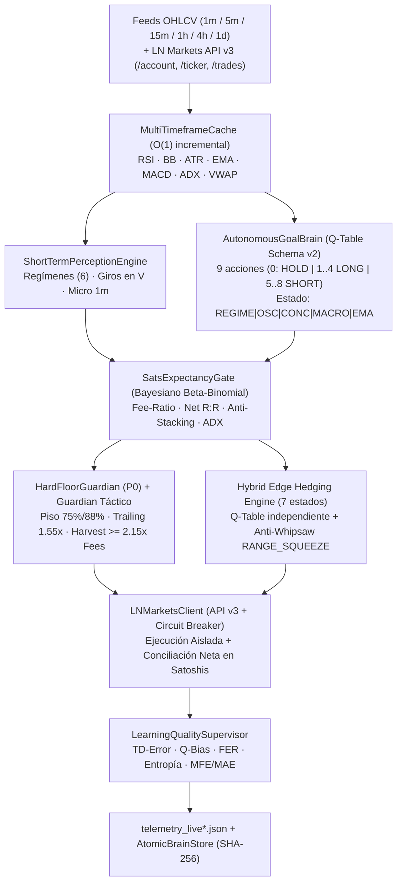

# LNM Sniper v7.3+ Dual

**Sistema autónomo de trading cuantitativo para Bitcoin en LN Markets (API v3)** con arquitectura dual (`Mainnet` + `Testnet`), Reinforcement Learning tabular (Q-Learning), motor de cobertura híbrido (*Hybrid Edge Hedging*), supervisión matemática en tiempo real y protecciones de capital de grado producción.

Optimizado para ejecutarse de forma ligera y determinista en **WSL (`Ubuntu`)**, **Linux** y **Termux (Android)** sin dependencias compiladas pesadas.

---

## Tabla de Contenidos

1. [Arquitectura General](#arquitectura-general)
2. [Componentes Clave](#componentes-clave)
3. [Requisitos e Instalación](#requisitos-e-instalación)
4. [Configuración de Credenciales (.env)](#configuración-de-credenciales-env)
5. [Uso Diario con el CLI (`sniper_cli.py`)](#uso-diario-con-el-cli-sniper_clipy)
6. [Perfiles Cuantitativos y Hot-Reload](#perfiles-cuantitativos-y-hot-reload)
7. [Script Legado (`setup_dual_sniper.sh`)](#script-legado-setup_dual_sniper_sh)
8. [Simulación, Entrenamiento y Certificación Monte Carlo](#simulación-entrenamiento-y-certificación-monte-carlo)
9. [Pruebas Automatizadas y Verificación](#pruebas-automatizadas-y-verificación)
10. [Mapa Completo de Archivos](#mapa-completo-de-archivos)
11. [Reglas de Seguridad P0 y Gobernanza](#reglas-de-seguridad-p0-y-gobernanza)

---

## Arquitectura General



---

## Componentes Clave

### 1. Cerebro Q-Learning (`AutonomousGoalBrain`)
- **9 acciones discretas inviolables (`0..8`):**
  - `0`: `HOLD / NO_TRADE`
  - `1..4` (`LONG`) y `5..8` (`SHORT`): `TREND`, `REVERSION`, `SNIPER`, `DEF_SCALP`.
- **Espacio de estados de 5 segmentos:** `REGIME|OSC|CONC|MACRO|EMA`.
- **Contabilidad real en satoshis netos:** la recompensa consolida el PnL neto liquidado real de LN Markets (`pl - opening_fee - closing_fee - funding_fee`, sin doble descuento cuando `real_balance_delta_sats` o `pl_includes_fees=True` están presentes), penalizando excursiones adversas (`MAE`) y tiempo de inmovilización.
- **Anti-monopolio sin aleatoriedad:** si el supervisor detecta colapso de entropía (`policy_collapse_detected`), aplica un desempate suave (`-0.06`) sobre la acción monopolista sin mutar la Q-table ni reintroducir exploración aleatoria en Mainnet.

### 2. Percepción Multi-Timeframe y Filtros de Entrada
- **`MultiTimeframeCache`:** mantiene en caché velas y volumen de `1m`, `5m`, `15m`, `1h`, `4h` y `1d` (retornando siempre la 3-tupla `(h, l, c)` en `get_candles()`), con actualización incremental $O(1)$ de `RSI`, `BB`, `ATR`, `EMA (9/21/50/200)`, `macd_norm`, `adx` (Wilder 14) y `vwap`.
- **`SatsExpectancyGate`:**
  - Estima probabilidad de éxito Bayesiana jerárquica (`p_hat`, `p_lcb`) por estilo/régimen.
  - Bloquea entradas en `RANGE_SQUEEZE + HIGH_EXP`, caída libre (`MICRO_1M_FALLING_KNIFE`), picos alcistas (`MICRO_1M_BULL_SPIKE`), tendencia débil (`ADX < 16.0` para `TREND`) y apilamiento en el mismo lado sin SL asegurado (**Guardia Anti-Stacking**).
  - Escala la concurrencia según capital real (`equity // 10000`, máximo 5 en Mainnet).

### 3. Guardián Táctico y `HardFloorGuardian` (P0)
- **Piso duro de capital:** protege el `75%` del pico inicial (`INITIAL_FLOOR_RATIO`) y el `88%` al conquistar metas (`MILESTONE_FLOOR_RATIO`).
- **Límites P0:** Drawdown máximo (`16%` en Mainnet), pérdida diaria máxima (`11%`) y Kill-Switch automático (`22%`).
- **Trailing Stop y Cosechas anti-Fee-Drag:** el bloqueo de trailing exige asegurar al menos `1.55x fee_offset` con piso de escala `0.65x`, y las cosechas (`HARVEST`) exigen $\ge 2.15\times$ `fee_offset` ($\text{FER} \ge 1.15$).

### 4. Hybrid Edge Hedging Engine (7 Estados)
- Módulos: `edge_monitor.py`, `predictive_hedge.py`, `portfolio_hedge.py`, `hedge_risk_manager.py`, `dynamic_hedge.py`, `adaptive_controller.py`, `hedge_state_store.py`.
- Opera una máquina de 7 estados con histéresis (`NORMAL -> WARNING -> HEDGE_CANDIDATE -> HEDGE_ACTIVE -> HEDGE_ADJUST -> RECOVERY -> HEDGE_EXIT`) y una Q-table independiente de 7 acciones.
- Incluye bloqueo específico contra whipsaw en compresión lateral (`BLOCKED_HEDGE_SQUEEZE_WHIPSAW_RISK` en `RANGE_SQUEEZE` / `CHOP_HIGHVOL` cuando `adverse_continuation_prob < 0.78`) y validación estricta de ahorro neto positivo superior a comisiones.

### 5. Supervisión Matemática y Hot-Reload Atómico
- **`LearningQualitySupervisor`:** monitorea en vivo los 5 signos vitales (`TD-Error`, `Q-Bias`, `FER`, `Entropía de Política` y `Captura MFE/MAE`) y activa respuestas automáticas (*Learning Guard*, boost de expectancy, ajuste de trailing).
- **`LearningThresholdsManager`:** gestiona los **78 umbrales** en 10 categorías dentro de `config/learning_thresholds.json` con validación de rango, rechazo ante sintaxis corrupta, **candado estructural** cuando existen posiciones abiertas y recarga en caliente sin reiniciar el bot (`< 2s` o vía `SIGHUP`).

### 6. Persistencia Atómica e Integridad Criptográfica
- **`AtomicBrainStore`:** todas las lecturas/escrituras de `q_brain_advanced_lnm.json`, `q_brain_testnet_lnm.json`, `hedge_state_mainnet.json` y `hedge_state_testnet.json` operan bajo locks POSIX (`fcntl`), escritura temporal + `fsync` + respaldo `.bak` y verificación estricta `strict_sha=True` (`.sha256`).

---

## Requisitos e Instalación

- **Python:** 3.9 o superior.
- **Sistema:** Linux, WSL (`Ubuntu`) o Android Termux (requiere soporte POSIX `fcntl`).
- **Dependencias ligeras:** `requests` y `numpy`.

```bash
# En WSL (Ubuntu) o Linux
cd /mnt/c/Users/mberm/OneDrive/Documentos/sniper
pip install requests numpy

# En Android Termux
pkg update && pkg install python
pip install --upgrade pip requests numpy
```

---

## Configuración de Credenciales (.env)

Crea o edita el archivo `.env` en la raíz del proyecto con llaves activas de **LN Markets API v3** (separadas por entorno):

```env
# Producción (Mainnet)
LNM_API_KEY=tu_api_key_v3_mainnet
LNM_API_SECRET=tu_api_secret_v3_mainnet
LNM_PASSPHRASE=tu_passphrase_mainnet

# Explorador (Signet Testnet)
LNM_TESTNET_API_KEY=tu_api_key_v3_testnet
LNM_TESTNET_API_SECRET=tu_api_secret_v3_testnet
LNM_TESTNET_PASSPHRASE=tu_passphrase_testnet
```

> **Nota:** `load_saved_credentials()` busca en variables de entorno, `.env`, `~/.env` y `~/.bashrc`. Asegúrate de usar llaves **API v3** vigentes y sin comillas sueltas.

---

## Uso Diario con el CLI (`sniper_cli.py`)

`sniper_cli.py` es el centro de mando principal del proyecto. Está optimizado para **Termux** (arranque ligero por *lazy-imports*, ajuste automático a pantallas estrechas de 42–65 columnas y cancelación limpia por paso con `Ctrl+C`).

### Menú Interactivo Guiado
```bash
python3 sniper_cli.py
```
Abre un menú numerado (`[0-8]`) para consultar estado, abrir monitor en vivo, explorar o modificar parámetros con su ficha matemática, cambiar presets, controlar demonios (`normal`, `shadow`, `safe-mode`) y administrar cerebros.

### Comandos Directos Más Útiles

| Objetivo | Comando |
| :--- | :--- |
| **Ver estado en vivo (API v3 + cerebros + signos vitales RL)** | `python3 sniper_cli.py status --env mainnet` |
| **Ver estado solo con archivos locales (sin red)** | `python3 sniper_cli.py status --env mainnet --offline` |
| **Monitor en vivo con auto-refresco** | `python3 sniper_cli.py watch --env mainnet --interval 3` |
| **Iniciar demonio en segundo plano** | `python3 sniper_cli.py daemon start --env mainnet` |
| **Iniciar en modo Seguro / Sombra** | `python3 sniper_cli.py daemon start --env mainnet --safe-mode` (o `--shadow`) |
| **Reiniciar / Detener / Recargar config (`SIGHUP`)** | `python3 sniper_cli.py daemon restart --env mainnet` / `stop` / `reload` |
| **Ver últimas líneas del log** | `python3 sniper_cli.py daemon logs --env mainnet --lines 40` |
| **Explorar catálogo de 99 parámetros** | `python3 sniper_cli.py catalog --search expectancy` |
| **Ver ficha matemática de un parámetro** | `python3 sniper_cli.py explain min_expectancy_ratio` |
| **Ajustar un umbral en caliente (nombre corto o completo)** | `python3 sniper_cli.py set trailing_tighten_factor 0.85` |
| **Ver / Cambiar parámetros de arranque (`RUNTIME_BOOT`)** | `python3 sniper_cli.py runtime-list` / `runtime-set MAX_LEVERAGE 60` |
| **Restaurar overrides de runtime a fábrica** | `python3 sniper_cli.py runtime-reset` |
| **Administrar cerebros (`info`, meta en sats, sync, limpieza)** | `python3 sniper_cli.py brain set-target --sats 350k --env mainnet` |
| **Sincronizar conocimiento Testnet -> Mainnet** | `python3 sniper_cli.py brain sync --dry-run` (quitar `--dry-run` para aplicar) |

---

## Perfiles Cuantitativos y Hot-Reload

El sistema incluye 5 perfiles preconfigurados en `sniper_cli_catalog.py`:

| Preset | Enfoque Operativo | Apto Live Mainnet |
| :--- | :--- | :--- |
| `baseline_v73` | Calibración oficial equilibrada v7.3+ (Monte Carlo 18m) | Sí |
| `capital_fortress` | Preservación estricta: `min_expectancy_ratio=4.60`, `MAX_LEVERAGE=50x`, `Kelly=0.15` | Sí |
| `fee_sniper_anti_chop` | Combate al *fee drag*: `min_net_to_cost_ratio=3.60`, `fer_cooldown_mult=3.0` | Sí |
| `trend_expansion_kelly` | Captura de tendencias y rupturas: `min_net_rr=1.30`, `Kelly=0.32` | Sí |
| `testnet_curriculum_lab` | Exploración acelerada (`epsilon_explorer_initial=0.32`, exclusivo Testnet/Shadow) | **No** (bloqueado P0 en Mainnet) |

```bash
python3 sniper_cli.py presets list
python3 sniper_cli.py presets show fee_sniper_anti_chop
python3 sniper_cli.py presets apply fee_sniper_anti_chop --env mainnet
```

---

## Script Legado (`setup_dual_sniper.sh`)

`setup_dual_sniper.sh` sigue disponible para utilidades rápidas (`setup`, `sync`, `rotate-logs`), pero **no debe mezclarse con `sniper_cli.py daemon`**:
- `setup_dual_sniper.sh` ejecuta directamente `lnm_sniper_v6_advanced.py` ignorando los overrides de `config/cli_runtime_overrides.json` y busca procesos con otro patrón (`lnm_sniper_v6_advanced.py` vs `sniper_cli.py _runner`).
- Para operación diaria, usa **`sniper_cli.py`**.

---

## Simulación, Entrenamiento y Certificación Monte Carlo

El paquete `simulation/` permite descargar velas históricas reales de Binance, entrenar cerebros candidatos con `--reset` y certificarlos mediante pruebas de estrés Monte Carlo antes de promoverlos a Testnet o Mainnet:

```bash
# 1. Descargar histórico de velas 1m (guardado en simulation/data/, excluido de Git)
python3 simulation/download_historical_data.py

# 2. Entrenar cerebro candidato desde cero sobre ventanas históricas
python3 simulation/train_candidate_brain.py --reset

# 3. Certificar mediante 3 compuertas (Schema v2, P0, Monte Carlo 0 mutaciones)
python3 simulation/certify_and_promote_candidate.py
```

También está disponible la recalibración offline orientada a satoshis netos:
```bash
python3 retrain_sats_offline.py          # genera copia .recalibrated.json
python3 retrain_sats_offline.py --apply  # aplica solo sin posiciones abiertas
```

---

## Pruebas Automatizadas y Verificación

Todas las pruebas deben ejecutarse en **Linux / WSL (`Ubuntu`)** de forma secuencial.

> **Importante si los bots están corriendo en vivo:** algunas suites (`test_learning_quality_and_sats.py`, `test_protocolo_v_reversal.py`) escriben en `telemetry_live.json` o `walk_forward_oos_report.json`. Si tienes demonios activos en el directorio raíz, ejecuta la batería sobre una copia aislada en `/tmp` para evitar colisiones de locks.

```bash
# Batería principal (CLI + Calidad de Aprendizaje + Protocolo Cuantitativo 23 escenarios)
python3 test_sniper_cli.py && \
python3 test_learning_quality_and_sats.py && \
python3 test_protocolo_v_reversal.py

# Batería del simulador y certificación Monte Carlo
python3 -m unittest \
  test_simulation_engine.py \
  test_terminal_bellman_fix.py \
  test_candidate_certification.py \
  test_simulation_training_loop.py
```

---

## Mapa Completo de Archivos

| Archivo / Directorio | Responsabilidad |
| :--- | :--- |
| `lnm_sniper_v6_advanced.py` | Bucle principal, caché MTF (`1m`–`1d`), `AutonomousGoalBrain` y `execute_strategy_guardian` |
| `guardian_execution_core.py` | `AtomicBrainStore` (SHA-256), `FileLockContext`, `HardFloorGuardian`, `InFlightOrderGuard` |
| `sniper_perception_sats_core.py` | `MarketRegimeClassifier`, `ShortTermPerceptionEngine` y `SatsExpectancyGate` |
| `learning_thresholds_manager.py` | Gestor con Hot-Reload atómico, validación de límites y candado estructural |
| `learning_quality_supervisor.py` | Monitor de signos vitales (`TD-Error`, `Q-Bias`, `FER`, `Entropía`, `MFE/MAE`) y telemetría |
| `config/learning_thresholds.json` | Fuente única de verdad de los 78 umbrales en 10 categorías |
| `sniper_cli.py` / `sniper_cli_catalog.py` | Centro de mando CLI optimizado para Termux, consultas API v3 en vivo y catálogo de 99 parámetros |
| `edge_monitor.py` / `predictive_hedge.py` | Detección de degradación de edge y pronóstico neto de cobertura vs SL |
| `portfolio_hedge.py` / `hedge_risk_manager.py` | Contabilidad del par cubierto y autorización subordinada al piso duro P0 |
| `dynamic_hedge.py` / `adaptive_controller.py` | Ejecución API v3 y máquina de 7 estados con Q-learning de coberturas |
| `hedge_state_store.py` | Persistencia atómica SHA-256 de `hedge_state_*.json` |
| `sync_brains_dual.py` / `init_clean_brains.py` | Nutrición segura Testnet $\rightarrow$ Mainnet y reseteo limpio de contadores conservando política Q |
| `retrain_sats_offline.py` / `validate_walk_forward_oos.py` | Recalibración offline y validación Walk-Forward Out-of-Sample |
| `simulation/` | Simulador de exchange (`sim_lnm_exchange.py`), feed, entrenamiento y certificación Monte Carlo |
| `test_*.py` | Suites de pruebas unitarias, cuantitativas y de certificación |
| `AGENTS.md`, `AGENT_MAINTENANCE_DIRECTIVE.md`, `CONTEXT_LNM_SNIPER.md` | Gobernanza por etapas, reglas P0, arquitectura de subagentes y memoria del proyecto |

---

## Reglas de Seguridad P0 y Gobernanza

1. **Invariantes P0:** Se mantienen estrictamente las 9 acciones (`0..8`), el formato de estado de 5 segmentos, la contabilidad sin doble descuento de comisiones, la subordinación a `HardFloorGuardian`, el tope de 5 posiciones en Mainnet y la integridad `strict_sha=True`.
2. **Gobernanza por Etapas:** Cualquier modificación estructural sigue el protocolo de 5 etapas documentado en `AGENT_MAINTENANCE_DIRECTIVE.md` y la orquestación de subagentes definida en `AGENTS.md`.
3. **Advertencia de Riesgo:** El trading algorítmico de derivados apalancados conlleva riesgo de pérdida de capital. Valida siempre tus cambios y parámetros en `Testnet` o con `--safe-mode` / `--shadow` antes de operar en `Mainnet`.
