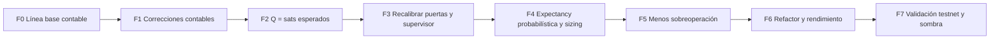

# Auditoría de Rentabilidad Neta en Satoshis — LNM Sniper v7.3+
### Informe técnico y hoja de ruta (Etapa 1: solo lectura, no se modificó código)

> [!IMPORTANT]
> Este informe es la **Etapa 1 (inspección y diagnóstico)** según [AGENT_MAINTENANCE_DIRECTIVE.md](file:///c:/Users/mberm/OneDrive/Documentos/sniper/AGENT_MAINTENANCE_DIRECTIVE.md). No se ha editado ningún archivo. Cada fase de la hoja de ruta necesita tu aprobación antes de ejecutarse.

---

## 1. Resumen ejecutivo

**Conclusión principal:** el bot **sí tiene una ventaja bruta**, pero **las comisiones se la comen**. Además, el motor de aprendizaje mezcla unidades y conceptos de forma que la IA **sobrevalora operar** frente a no operar. Eso lleva a operar de más, y operar de más significa pagar más comisiones.

| Métrica (de [q_brain_advanced_lnm.json](file:///c:/Users/mberm/OneDrive/Documentos/sniper/q_brain_advanced_lnm.json)) | Valor |
| :--- | :--- |
| Operaciones cerradas | 336 |
| PnL neto registrado | **−1,054 sats** |
| Comisiones registradas | **11,722 sats** (≈ 34.9 sats/operación) |
| PnL bruto implícito (neto + comisiones) | ≈ +10,668 sats (≈ +31.7 sats/operación) |
| **Bruto / comisiones** | **0.91** (hace falta > 1.0 solo para no perder) |
| Win rate en la muestra por estilo (22 ops) | 22.7% (5/22) |
| Recompensas positivas en la memoria de replay | 51% (97/189) ← **no cuadra con un WR del 23%** |
| Valores Q que tocan el techo de recorte antiguo (0.95) | Sí → hay saturación |

> [!WARNING]
> El −1,054 sats probablemente **subestima la pérdida real**. La fórmula contable antigua solo restaba el 50% de la comisión taker en las operaciones perdedoras. El neto real tiene que reconstruirse con el historial de LN Markets (Fase 0).

**Lo que significa:** con una mejora de ~10% en el bruto por operación, o una reducción de ~9% en comisiones (por ejemplo, operando menos y con más recorrido), el sistema llegaría al punto de equilibrio. Las correcciones de abajo apuntan justo a eso.

---

## 2. La economía de las comisiones

### 2.1 La comisión es fija en % de precio, no depende del apalancamiento
La comisión de ida y vuelta es ≈ **0.20% del nocional** (0.10% al abrir + 0.10% al cerrar). Eso implica:

- **El precio tiene que moverse al menos 0.20% a favor** (más slippage) solo para cubrir comisiones, con cualquier apalancamiento.
- Medido sobre el margen: comisión/margen = apalancamiento × 0.2% → 15x = 3%, 35x = 7%, **85x = 17% del margen por operación**.

### 2.2 Win rate necesario para no perder
Para una operación con ganancia bruta $G$ (en TP), pérdida bruta $L$ (en SL) y coste total $C$:

$$E = p\,(G - C) - (1-p)\,(L + C) \ge 0 \;\;\Longrightarrow\;\; p^{*} = \frac{L + C}{G + L}$$

**Ejemplo con la estrategia REVERSION** (`sl_atr = 1.6`, `rr = 2.4`) y un ATR(5m) de referencia de ~0.15% del precio:

| Concepto | Sin comisiones | Con comisiones 0.20% |
| :--- | :--- | :--- |
| SL | 0.24% | 0.24% |
| TP | 0.576% | 0.576% |
| **Win rate mínimo $p^{*}$** | **29.4%** | **53.9%** |
| Win rate observado (REVERSION, 16 ops) | 25% | 25% |

> [!CAUTION]
> Las comisiones **casi duplican el win rate necesario**. Con stops y objetivos de 1–2 ATR en 5m, el coste de 0.20% equivale a ~1.3 ATR. Hacer scalping con estos parámetros es estructuralmente deficitario salvo que el filtro de entrada sea muy selectivo.

---

## 3. Hallazgos de la auditoría

Ordenados por impacto en sats. Para cada uno: **problema → por qué importa → corrección propuesta (descrita, sin código)**.

> [!NOTE]
> Por transparencia: algunos hallazgos (C3, A1, A2, M1) vienen de la implementación anterior de esta misma conversación. Se incluyen porque afectan la rentabilidad real.

### 🔴 CRÍTICOS (afectan directamente a los sats)

#### C1 — La Q no representa "sats esperados por operación"
- **Dónde:** [`_update_q`](file:///c:/Users/mberm/OneDrive/Documentos/sniper/lnm_sniper_v6_advanced.py#L1291-L1331), con `gamma_discount = 0.92`.
- **Problema:** cada cierre se actualiza con $R + \gamma \max_{a'} Q(s',a')$. Si la Q de los estados es parecida, el punto fijo queda en:
  $$Q^{*} \approx \frac{E[R]}{1-\gamma} = 12.5 \times E[R]$$
  Además, el $\max$ sobre 9 acciones con ruido produce **sesgo de maximización**, que es optimista.
- **Por qué importa:** las puertas de entrada, el Q-Bias (`Q × 100 = sats`) y el "Kelly" tratan Q como sats esperados por operación, pero Q es otra cosa: un valor descontado de operaciones futuras e inflado. Las decisiones comparan magnitudes que no son comparables.
- **Corrección:** tratar cada operación como un **episodio terminal** (bandit contextual): $\gamma = 0$ en los cierres, de forma que $Q(s,a) \leftarrow Q + \alpha\,(R - Q)$. Así Q estima directamente los sats netos esperados / escala.

#### C2 — NO_TRADE está anclado artificialmente → sesgo hacia operar
- **Dónde:** [línea 915](file:///c:/Users/mberm/OneDrive/Documentos/sniper/lnm_sniper_v6_advanced.py#L915) (al cargar) y [línea 1440](file:///c:/Users/mberm/OneDrive/Documentos/sniper/lnm_sniper_v6_advanced.py#L1440). `Q[0]` se recorta a [0.005, 0.025] y nunca aprende.
- **Por qué importa:** las acciones de trading (infladas por C1) siempre se comparan contra una constante diminuta. Eso empuja a **operar de más → más comisiones**.
- **Corrección:** fijar NO_TRADE como **línea base de 0 sats** (no operar no gana ni pierde) y operar solo si la **cota inferior de confianza** del valor esperado es > 0.

#### C3 — El slippage se resta dos veces del neto
- **Dónde:** [`compute_trade_economic_breakdown`](file:///c:/Users/mberm/OneDrive/Documentos/sniper/sniper_perception_sats_core.py#L505-L510), cuyo resultado se pasa como `real_balance_delta_sats` en la [línea 2694](file:///c:/Users/mberm/OneDrive/Documentos/sniper/lnm_sniper_v6_advanced.py#L2694).
- **Problema:** el `pl` de LN Markets ya se calcula desde el **precio real de ejecución**, así que el slippage ya está dentro de `pl`. Restarlo otra vez penaliza de más cada operación. Además, el slippage se suma a `total_fees_paid_sats`, y no es una comisión.
- **Corrección:** neto real = `pl − opening_fee − closing_fee − sum_carry_fees`. El slippage se registra solo como métrica de diagnóstico de calidad de ejecución. Cuando sea posible (un único cierre sin aperturas simultáneas), conciliar contra la variación real de `/account.balance`.

#### C4 — Operaciones cerradas que nunca se contabilizan ni se aprenden
- **Dónde:** [líneas 2655–2658](file:///c:/Users/mberm/OneDrive/Documentos/sniper/lnm_sniper_v6_advanced.py#L2655-L2658). Primero se hace `pop` de `active_trades` y después se busca en los últimos 25 cerrados.
- **Problema:** si el cierre no aparece todavía (retraso de la API, o más de 25 cierres), la operación se borra y se pierde para siempre: no entra en la contabilidad ni en el aprendizaje. Además, el conjunto de idempotencia `processed_closed_trade_ids` no se guarda en disco, así que se pierde al reiniciar.
- **Corrección:** una **cola de liquidación pendiente**. La operación sale de `active_trades` solo cuando su cierre está confirmado, con reintentos y paginación. Guardar los últimos N IDs procesados como campo opcional del cerebro (compatible con el formato actual).

#### C5 — La "puerta de expectancy" no calcula expectancy
- **Dónde:** [`verify_net_sats_expectancy`](file:///c:/Users/mberm/OneDrive/Documentos/sniper/sniper_perception_sats_core.py#L558) usa `fee_ratio = TP_bruto / coste ≥ 3.85`.
- **Problema:** solo mira el escenario de TP e **ignora la probabilidad de llegar a él**. Un TP lejano pasa el filtro aunque se alcance pocas veces.
- **Corrección:** expectancy real $E = \hat p\,(G-C) - (1-\hat p)(L+C)$, con $\hat p$ estimado por estado/acción (Beta-Binomial con agregación jerárquica hacia régimen → estilo → global). Operar solo si $E_{\text{LCB}} > 0$ y $\hat p_{\text{LCB}} > p^{*}$ + margen.

### 🟠 ALTOS

#### A1 — Umbrales en "unidades Q" desajustados tras el cambio de escala
- Con `reward_scale_sats = 100` y recorte en ±2, una operación normal de ±100–300 sats produce TD-errors de 1–3 unidades. Siguen fijos y calibrados para la escala antigua:
  - Puertas: `rq < 0.04`, `rq ≤ −0.15`, `min_req_q = 0.015` ([core L390–L470](file:///c:/Users/mberm/OneDrive/Documentos/sniper/sniper_perception_sats_core.py#L390-L470))
  - "Kelly": `q ≥ 0.08 / 0.03` ([L2924](file:///c:/Users/mberm/OneDrive/Documentos/sniper/lnm_sniper_v6_advanced.py#L2924)) y penalización LCB `0.12/√n` ([L1270](file:///c:/Users/mberm/OneDrive/Documentos/sniper/lnm_sniper_v6_advanced.py#L1270))
  - TD-Error: `0.45 / 0.85 / 1.35` absolutos
- **Riesgo concreto: bloqueo del Learning Guard.** Operaciones normales se clasifican como CRITICAL y el aprendizaje se suspende. Mientras está suspendido la Q no cambia, y para reactivarse se exigen 5 actualizaciones seguidas con |δ| < 0.85. Si el ruido natural de las recompensas supera ese valor, **el aprendizaje puede quedar congelado indefinidamente**.
- **Corrección:** expresar todos los umbrales **en sats** y usar un **TD-error normalizado** (z-score frente a la desviación móvil de las recompensas). La divergencia se detecta por **tendencia** de $\overline{|\delta|}/\sigma_R$, no por magnitud absoluta.

#### A2 — La regla "una pérdida siempre baja Q" rompe la convergencia
- **Dónde:** [líneas 1308 y 1327](file:///c:/Users/mberm/OneDrive/Documentos/sniper/lnm_sniper_v6_advanced.py#L1308-L1327) (`signed_td = min(raw_td, r)`).
- **Problema:** si Q = −1.5 y una pérdida pequeña da r = −0.3, el valor estadísticamente correcto es *subir* hacia −0.3. La regla fuerza a bajar más, y con pérdidas repetidas Q acaba en el suelo (−2) **sea cual sea el tamaño real de las pérdidas**.
- **Corrección:** la garantía correcta es que el **objetivo** de una pérdida sea ≤ R (sin bootstrapping optimista). Con $\gamma = 0$ (C1) esto se cumple solo y la regla especial sobra.

#### A3 — El replay de experiencia reinyecta recompensas contaminadas
- La memoria cargada (189 transiciones) tiene recompensas de la **fórmula antigua con bonos**: 51% positivas frente a un WR del 23%. El replay las vuelve a aplicar en cada cierre (18 muestras) y también en **cada cierre de vela macro** ([L1190](file:///c:/Users/mberm/OneDrive/Documentos/sniper/lnm_sniper_v6_advanced.py#L1190)), sin datos nuevos. Además, el muestreo priorizado no corrige el sesgo (no usa importance sampling).
- **Corrección:** etiquetar la memoria con `reward_schema_version`, descartar o reescalar la memoria antigua, quitar el replay de los cierres macro y usar muestreo uniforme o con corrección IS.

#### A4 — Racha de pérdidas contada dos veces
- Una misma pérdida suma +1 en [L2708](file:///c:/Users/mberm/OneDrive/Documentos/sniper/lnm_sniper_v6_advanced.py#L2708) (cierre contable) y otra vez en [L2747](file:///c:/Users/mberm/OneDrive/Documentos/sniper/lnm_sniper_v6_advanced.py#L2747) (heurística "STOP-OUT" basada en equity, que además incluye el PnL flotante de otras posiciones). El resultado son pausas prematuras y reducción de riesgo distorsionada.
- **Corrección:** una única fuente para la racha: el cierre liquidado y confirmado.

#### A5 — La recompensa mezcla la estimación del valor con la aversión al riesgo
- `loss_penalty_multiplier = 1.35`, `min(econ, net)` y −0.035 en recovery hacen que Q sea **sesgada a la baja a propósito**, mientras que el Q-Bias asume que Q es insesgada. Las dos métricas se contradicen.
- **Corrección:** recompensa = **sats netos sin sesgo** (opcionalmente con un término de MAE documentado). La aversión al riesgo se aplica en la **decisión** (LCB o CVaR), no en el estimador.

#### A6 — Tamaño de posición por % de margen, no por riesgo
- `adj_risk` (3–11% del equity como margen) no relaciona el tamaño con la pérdida real en el SL. El "Kelly" depende de valores Q en la escala equivocada.
- **Corrección:** tamaño = (equity × riesgo%) / pérdida en sats en el SL, incluyendo comisiones. Kelly fraccionado (¼) con $f^{*} = (p\,b - (1-p))/b$, usando $p$ y $b$ estimados en sats.

#### A7 — Exploración con dinero real y contadores mal medidos
- En mainnet, ε ≥ 0.06 en estados con menos de 25 visitas abre operaciones **aleatorias con dinero real**. ε decae dos veces (en `choose_action` y al entrenar). `state_visits` cuenta **decisiones**, no resultados ([L1227](file:///c:/Users/mberm/OneDrive/Documentos/sniper/lnm_sniper_v6_advanced.py#L1227)), así que la penalización por incertidumbre baja sin que haya datos nuevos.
- **Corrección:** ε ≈ 0 en mainnet y exploración solo en testnet (ya existe la fusión dual). Contadores **por (estado, acción) y por resultado liquidado**.

### 🟡 MEDIOS

| # | Hallazgo | Corrección |
| :--- | :--- | :--- |
| M1 | **Parámetros del JSON sin conectar o incoherentes:** `funding_rate_8h_est`, `target_mfe_capture_ratio`, `healthy_normalized_entropy`, `squeeze_bb_width_pct` y `expansion_atr_rel_ratio` no se usan (0 referencias). `edge_degradation_*` vale +0.40/0.60/0.78 en el JSON pero `Config` usa −0.22/−0.38/−0.60 y no lo lee. `atr_extreme_pct` = 0.9 (%) frente a `Config.ATR_EXTREME_PCT` = 0.0145 (fracción). Siguen fijos en código los umbrales de `MarketRegimeClassifier`, las puertas Q y `HardFloorGuardian`. **La "fuente única de verdad" está incompleta** y la tabla del informe anterior la presentaba como completa. | Conectar o eliminar cada parámetro, unificar unidades y añadir un test que falle si hay claves del JSON sin consumidor |
| M2 | MFE/MAE se mide con `pl` **bruto** de las posiciones abiertas y se compara con el **neto** realizado ([L2147](file:///c:/Users/mberm/OneDrive/Documentos/sniper/lnm_sniper_v6_advanced.py#L2147)), así que la captura sale artificialmente baja. | Comparar bruto con bruto, o neto con neto |
| M3 | Las Q macro (1h/4h) usan `align_bonus` (premia acertar la dirección de BTC, no ganar sats) ([L1176](file:///c:/Users/mberm/OneDrive/Documentos/sniper/lnm_sniper_v6_advanced.py#L1176)) y sesgan la selección micro. | Recompensa macro = sats netos del ciclo |
| M4 | **Datos escasos:** 175 estados × 9 acciones = 1,575 celdas para 336 operaciones → ~0.2 muestras por celda. La dimensión `HIGH_EXP` depende del propio número de posiciones abiertas. | Agregación jerárquica y shrinkage (régimen → estilo → global) |
| M5 | Las operaciones adoptadas sin `entry_q` usan la Q del momento del cierre, lo que contamina el Q-Bias. | Excluirlas del Q-Bias |
| M6 | `sync_brains_dual` fusiona Q de testnet (otra escala, modo explorador) con mainnet. | Fusionar solo con el mismo `reward_schema_version` |
| M7 | Aproximación lineal frente al pago de un contrato inverso: error ≈ el % de movimiento (~0.5–1% relativo). | Fórmula inversa exacta (prioridad baja) |

### 🟢 BAJOS (código y sintaxis)
- `save_brain(force=True)` en cada cierre y adopción: E/S bloqueante en el bucle principal → guardado diferido (debounce) o en un hilo aparte.
- `main()` tiene ~450 líneas → separar en funciones (`process_settlements`, `manage_open_positions`, `evaluate_entry`).
- Se usa `print` en lugar de `logging` con niveles. Faltan type hints. Las variables no indican su unidad (`_sats`, `_pct`, `_ratio`).
- `transition_audit_log` solo vive en memoria → guardarlo en un JSONL rotativo para análisis offline.
- `sync_from_thresholds` se llama en cada evaluación de expectancy → cachear con un contador de versión.

---

## 4. Hoja de ruta de implementación

Cada fase sigue el ciclo de 5 etapas de la directiva (**Diagnóstico → Plan → Cambios → Pruebas → Documentación**) y necesita tu aprobación para pasar a la siguiente.

| Fase | Objetivo | Hallazgos | Archivos principales | Riesgo | Impacto esperado en sats |
| :--- | :--- | :--- | :--- | :--- | :--- |
| **F0** | **Línea base real:** script offline que reconstruya el neto exacto por operación desde el historial de LN Markets y calcule FER, WR y $p^{*}$ reales por estilo. Snapshot congelado del cerebro. | Base de C3–C5 | Script nuevo de solo lectura | Nulo (no toca trading) | Diagnóstico exacto; evita optimizar sobre datos sesgados |
| **F1** | Correcciones contables: slippage, cola de liquidación pendiente, IDs persistentes, racha única | C3, C4, A4 | `lnm_sniper_v6_advanced.py`, `sniper_perception_sats_core.py` | Bajo | Contabilidad fiel; ninguna operación sin registrar |
| **F2** | Semántica de Q: γ = 0 en cierres, NO_TRADE = 0, recompensa insesgada, quitar `min(raw_td, r)`, migración del cerebro (versión de esquema y purga de memoria antigua) | C1, C2, A2, A3, A5 | `lnm_sniper_v6_advanced.py`, `learning_quality_supervisor.py` | **Medio-alto** (cambia la política) | **Alto:** elimina el sesgo hacia operar |
| **F3** | Umbrales en sats, TD normalizado, arreglo del bloqueo del Learning Guard, conectar o eliminar claves huérfanas, MFE/MAE coherente | A1, M1, M2, M5 | Supervisor, JSON, puertas | Medio | Supervisor fiable; sin falsas alarmas |
| **F4** | Expectancy con $\hat p$ Beta-Binomial jerárquico, puerta $E_{\text{LCB}} > 0$, movimiento mínimo ≥ k × coste, sizing por riesgo + Kelly ¼ | C5, A6, M4 | `sniper_perception_sats_core.py`, `main` | Medio | **Alto:** filtra operaciones con $p < p^{*}$ |
| **F5** | ε ≈ 0 en mainnet, contadores (s,a), cooldown según FER, recompensa macro en sats, fusión dual por versión | A7, M3, M6 | Cerebro, `sync_brains_dual.py` | Bajo-medio | Menos operaciones → menos comisiones |
| **F6** | Refactor de `main`, guardado diferido, logging, type hints, auditoría en JSONL | Bajos | Varios | Bajo | Mantenibilidad y latencia |
| **F7** | Walk-forward OOS sobre datos conciliados + **modo sombra** (la nueva política registra decisiones sin ejecutarlas) + testnet ≥ 100 operaciones antes de mainnet | — | Validadores | Nulo | Evidencia antes de arriesgar capital |

> [!TIP]
> **Orden recomendado por relación beneficio/riesgo:** F0 → F1 → F2 + F3 juntas (dependen entre sí por la escala) → F4 → F5. Las fases F2–F5 deberían pasar primero por **testnet y modo sombra** (F7) antes de llegar a mainnet.

---

## 5. KPIs para medir el éxito

| KPI | Actual | Objetivo intermedio | Objetivo final |
| :--- | :--- | :--- | :--- |
| Bruto / comisiones | 0.91 | ≥ 1.5 | ≥ 2.5 |
| FER (neto / comisiones), ventana 20 | < 0 | ≥ 1.2 | ≥ 2.5 |
| WR observado − $p^{*}$ por estilo | ≈ −29 pts (REVERSION) | ≥ 0 | ≥ +5 pts |
| Comisiones por día | Sin medir (F0) | −30% | −50% |
| \|Q-Bias\| medio (sats) | No interpretable (C1) | ≤ 25 | ≤ 10 |
| Suspensiones del Learning Guard por operación normal | Probables (A1) | 0 | 0 |
| Operaciones perdidas sin contabilizar | Posibles (C4) | 0 | 0 |
| PnL neto en sats (30 días) | Negativo | ≥ 0 | > 0 de forma sostenida |

---

## 6. Componentes que no se tocarán en ninguna fase
- Las 9 acciones discretas y el formato de las claves de estado.
- La compatibilidad de [q_brain_advanced_lnm.json](file:///c:/Users/mberm/OneDrive/Documentos/sniper/q_brain_advanced_lnm.json): solo se añadirán campos opcionales (`reward_schema_version`, IDs procesados).
- `HardFloorGuardian` y `execute_strategy_guardian` (jerarquía P0).
- El límite de 5 posiciones simultáneas en mainnet.
- Compatibilidad con Termux: solo stdlib, `requests` y `numpy`.
